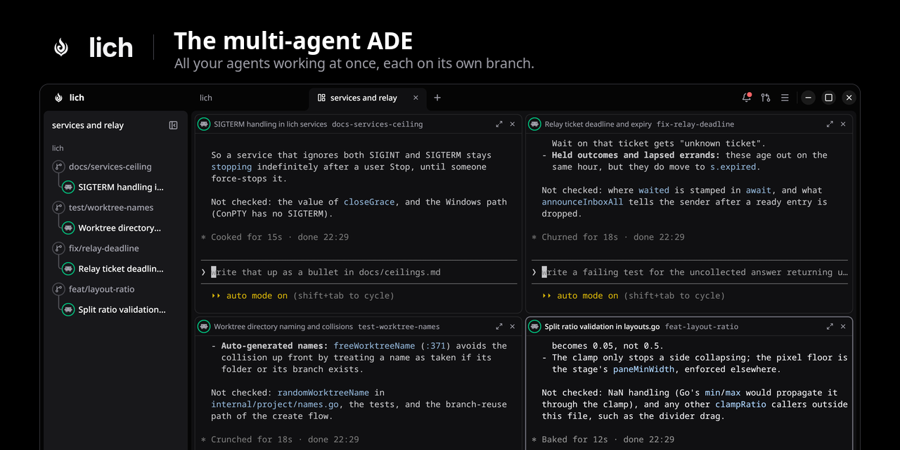

<a href="https://lichdotdev.github.io/lich/">
  
</a>

<p align="center">
  <a href="https://lichdotdev.github.io/lich/">Website</a>
  ·
  <a href="https://github.com/lichdotdev/lich">Code</a>
  ·
  <a href="https://github.com/lichdotdev/lich/releases">Releases</a>
  ·
  <a href="https://github.com/lichdotdev/lich/blob/main/docs/cli.md">CLI</a>
  ·
  <a href="https://github.com/lichdotdev/lich/blob/main/docs/themes.md">Themes</a>
  ·
  <a href="https://github.com/lichdotdev/lich/blob/main/docs/extensions.md">Extensions</a>
  ·
  <a href="https://github.com/lichdotdev/lich/blob/main/CHANGELOG.md">Changelog</a>
</p>

## About lich

**lich is the multi-agent ADE: all your agents working at once, each on its own branch.** Claude Code, Codex, opencode or the agent you already use, each in its own git worktree, all in one window, with diffs and pull requests in view.

A native window on Linux, macOS and Windows. No Electron, no browser.

## Getting started

```bash
curl -fsSL https://raw.githubusercontent.com/lichdotdev/lich/main/install.sh | sh
```

On macOS, `brew install --cask lichdotdev/tap/lich`. On Windows, grab the installer from [Releases](https://github.com/lichdotdev/lich/releases). Every other route is in [INSTALL.md](https://github.com/lichdotdev/lich/blob/main/INSTALL.md).

## The ecosystem

| Repo | What it is |
| --- | --- |
| [`lich`](https://github.com/lichdotdev/lich) | The app: a Go backend and a native window |
| [`lich-plugin`](https://github.com/lichdotdev/lich-plugin) | Session hooks that let lich read what each agent is doing |
| [`lich-intellij`](https://github.com/lichdotdev/lich-intellij) | IntelliJ IDEA plugin: send a selection, a file, a failed test or a diff to a lich session |
| [`noctalia-plugins`](https://github.com/lichdotdev/noctalia-plugins) | Your lich sessions in the Noctalia bar, a panel and the lock screen |
| [`homebrew-tap`](https://github.com/lichdotdev/homebrew-tap) | Homebrew cask for macOS |

### Extensions

An extension adds a screen of its own to lich. [`lich-notes`](https://github.com/lichdotdev/lich-notes) is a notes screen and the reference example; [docs/extensions.md](https://github.com/lichdotdev/lich/blob/main/docs/extensions.md) covers writing one.

### Themes

Install any of these from Settings › Appearance › **Import** by pasting the repo URL, or [write your own](https://github.com/lichdotdev/lich/blob/main/docs/themes.md).

[Catppuccin](https://github.com/lichdotdev/catppuccin-lich) ·
[Rosé Pine](https://github.com/lichdotdev/rose-pine-lich) ·
[Everforest](https://github.com/lichdotdev/everforest-lich) ·
[Eldritch](https://github.com/lichdotdev/eldritch-lich) ·
[Moonfly](https://github.com/lichdotdev/moonfly-lich) ·
[Bluloco](https://github.com/lichdotdev/bluloco-lich) ·
[Oceanic Next](https://github.com/lichdotdev/oceanic-next-lich) ·
[Cloud9 JetStream](https://github.com/lichdotdev/cloud9-jetstream-lich) ·
[Lotus](https://github.com/lichdotdev/lotus-lich)

### Gio libraries

Built for lich's window, usable in any [Gio](https://gioui.org) application.

| Repo | What it is |
| --- | --- |
| [`godemirror`](https://github.com/lichdotdev/godemirror) | A read-only code view and diff view |
| [`gio-driver`](https://github.com/lichdotdev/gio-driver) | Guided product tours, in the spirit of driver.js |

## Issues and feature requests

Please [search the existing issues](https://github.com/lichdotdev/lich/issues) first, then [open a new one](https://github.com/lichdotdev/lich/issues/new/choose) if nothing covers it.

## Contributing

Contributions are welcome. [CONTRIBUTING.md](https://github.com/lichdotdev/lich/blob/main/CONTRIBUTING.md) covers building from source and the local gate every PR runs.

## Sponsors

lich is written and maintained by one person, with no paid tier and no plan for one. [Sponsoring](https://github.com/sponsors/omartelo) keeps it that way.
