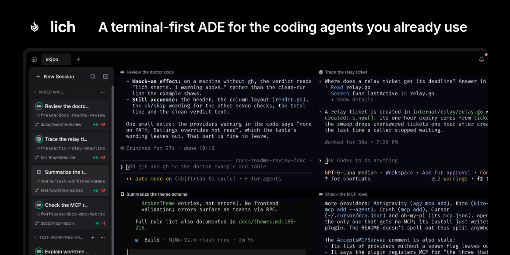

<a href="https://lichdotdev.github.io/lich/">
  
</a>

<p align="center">
  <a href="https://lichdotdev.github.io/lich/">Website</a>
  ·
  <a href="https://github.com/lichdotdev/lich">Code</a>
  ·
  <a href="https://github.com/lichdotdev/lich/releases">Releases</a>
  ·
  <a href="https://github.com/lichdotdev/lich/blob/main/docs/cli.md">CLI</a>
  ·
  <a href="https://github.com/lichdotdev/lich/blob/main/docs/themes.md">Themes</a>
  ·
  <a href="https://github.com/lichdotdev/lich/blob/main/CHANGELOG.md">Changelog</a>
</p>

## About lich

**lich is a terminal-first ADE for the coding agents you already use.** Open your projects, run Claude Code, Codex, opencode and five more in real terminals side by side, and keep git (worktrees, diffs and pull requests) in view without leaving the window.

One static Go binary, no Electron: the UI opens in lich's own embedded Chromium on Linux, macOS and Windows.

## Getting started

```bash
curl -fsSL https://raw.githubusercontent.com/lichdotdev/lich/main/install.sh | sh
```

On macOS, `brew install --cask lichdotdev/tap/lich`. On Windows, grab the installer from [Releases](https://github.com/lichdotdev/lich/releases). Every other route is in [INSTALL.md](https://github.com/lichdotdev/lich/blob/main/INSTALL.md).

## The ecosystem

| Repo | What it is |
| --- | --- |
| [`lich`](https://github.com/lichdotdev/lich) | The app: Go backend, React frontend, embedded Chromium shell |
| [`lich-plugin`](https://github.com/lichdotdev/lich-plugin) | Session hooks that let lich read what each agent is doing |
| [`homebrew-tap`](https://github.com/lichdotdev/homebrew-tap) | Homebrew cask for macOS |

### Themes

Install any of these from Settings › Appearance › **Import** by pasting the repo URL, or [write your own](https://github.com/lichdotdev/lich/blob/main/docs/themes.md).

[Catppuccin](https://github.com/lichdotdev/catppuccin-lich) ·
[Rosé Pine](https://github.com/lichdotdev/rose-pine-lich) ·
[Eldritch](https://github.com/lichdotdev/eldritch-lich) ·
[Moonfly](https://github.com/lichdotdev/moonfly-lich) ·
[Bluloco](https://github.com/lichdotdev/bluloco-lich) ·
[Oceanic Next](https://github.com/lichdotdev/oceanic-next-lich) ·
[Cloud9 JetStream](https://github.com/lichdotdev/cloud9-jetstream-lich) ·
[Lotus](https://github.com/lichdotdev/lotus-lich)

## Issues and feature requests

Please [search the existing issues](https://github.com/lichdotdev/lich/issues) first, then [open a new one](https://github.com/lichdotdev/lich/issues/new/choose) if nothing covers it.

## Contributing

Contributions are welcome. [CONTRIBUTING.md](https://github.com/lichdotdev/lich/blob/main/CONTRIBUTING.md) covers building from source and the local gate every PR runs.

## Sponsors

lich is written and maintained by one person, with no paid tier and no plan for one. [Sponsoring](https://github.com/sponsors/omartelo) keeps it that way.
